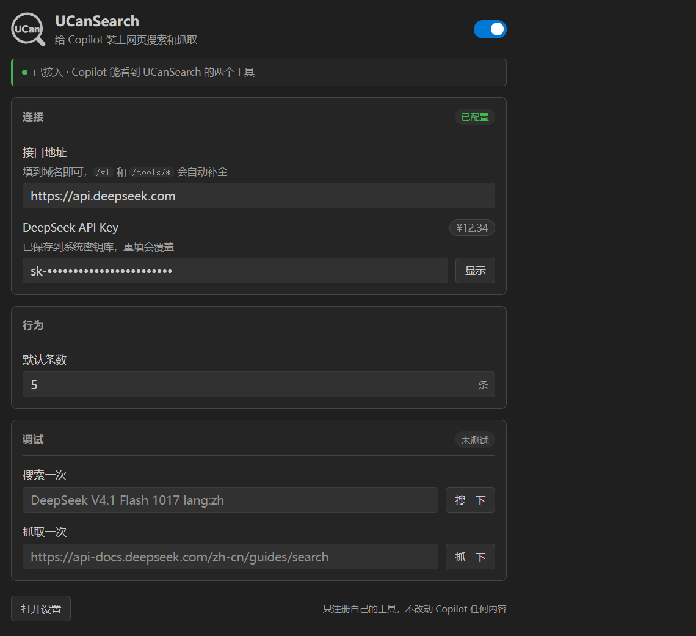

# UCanSearch for Copilot   

> **填一把 DeepSeek API Key，Copilot 就多出「搜索网页」和「抓取网页」两个工具——它终于能查新东西，而不是靠记忆编。**

**不想自己编译？两种装法**：到 [Releases 页面](https://github.com/ZoneYottaZenith/ucansearch-for-copilot/releases) 下载对应版本的 `.vsix`，然后 `code --install-extension <文件名>.vsix`，或在扩展视图右上角「…」→「从 VSIX 安装」。也可以按下面的「安装与调试」从源码跑起来。

给 GitHub Copilot 装上**网页搜索**和**网页抓取**——两个工具都直连 DeepSeek 官方的 Search / Fetch 接口，参数和返回字段跟官方文档一一对应，中间不经过任何第三方中转。

## 它补的是什么缺口

VS Code 自带的工具里只有 `fetch_webpage`：能打开一个已知网址，但**没有网页搜索**。所以 Copilot 想查点新东西时，只能靠猜 URL 或者干脆凭记忆编。

装上这个扩展后，Copilot 多了两件武器：

| 工具 | 引用名 | 作用 | 对应接口 |
|---|---|---|---|
| UCanSearch 网页搜索 | `searchWeb` | 按关键词搜网页，返回标题、链接、摘要、发布时间、相关度、权威性 | `POST /v1/tools/search` |
| UCanSearch 网页抓取 | `fetchWeb` | 打开单个网页，返回 Markdown 正文 | `POST /v1/tools/fetch` |

内置的 `fetch_webpage` 依然在，两者不冲突——我们的工具用自己的名字注册，不会覆盖任何内置能力。

## 不是替换 Copilot，而是增强它

Copilot 的聊天界面、Agent 模式、指令与 Skills、其他工具调用全部留在原处，本扩展只往它的工具列表里多挂两个工具；需要配置时才打开侧边栏面板。

- **零侵入**：不修改 Copilot 的任何设置，不接管它的请求，也不新增聊天界面；关掉总开关两个工具立即从列表里消失。
- **密钥只进系统密钥库**：存在 `SecretStorage`，永不写入 `settings.json`，也不会进 Git 历史。
- **零运行时依赖**：纯 VS Code API + Node 内置 `fetch`，不需要 Python、Docker 或本地代理进程。
- **结果原样交给模型**：正文不截断、不等分、不丢条，模型拿到什么就由它自己组织。

**关于插件名字。** `UCanSearch` 读作 *U Can Search*，取「你也能搜」的意思：搜索和抓取都在你和 DeepSeek 之间直连，工具照旧挂在 Copilot 原生的工具列表里。`for Copilot` 则划清边界——它是给 Copilot 增配，不是另一个聊天客户端。

<p align="center">
  
</p>
<p align="center"><sub>侧边栏面板：地址、Key、默认条数，加两个当场验一次的调试框</sub></p>

## 为什么是它

| 能力 | 说明 |
|---|---|
| 两行配置就能用 | 地址填到域名即可，`/v1` 和 `/tools/*` 自动补全；自建代理填带前缀的地址也认 |
| 两个工具各司其职 | 搜索负责找，抓取负责读全文；工具描述里已写明「先搜再抓」，减少瞎猜 URL |
| 余额看得见 | 面板右上角显示账户余额，点一下就重新拉，数字从零递增上去，花了多少一眼有数 |
| 当场可验 | 面板里两个调试框，填词 / 填网址即时发一次真实请求，返回内容原样显示 |
| 随时可回滚 | 关掉总开关，两个工具从 Copilot 的工具列表里消失，Copilot 恢复原状 |
| 密钥不外泄 | 输入框只回显掩码，中间打点；真 Key 只存在系统密钥库 |

## 配置项

| 设置 | 默认 | 说明 |
|---|---|---|
| `ucansearch.enabled` | `true` | 关掉后 Copilot 不再调用这两个工具 |
| `ucansearch.baseUrl` | `https://api.deepseek.com` | 填到域名即可，`/v1` 和 `/tools/*` 自动补；自建代理填带前缀的地址也行 |
| `ucansearch.defaultCount` | `5` | 模型没指定条数时用这个（1-50） |

API Key 存在 VS Code 的 SecretStorage 里，**不写进 settings.json**。

## 计费与限速

Search 和 Fetch 都由 DeepSeek 按**请求次数**计费：各 5 元 / 1000 次成功请求。失败、搜不到结果、超时都不计费；`count` 调大不会多收钱，只影响返回条数。

限速按账号算：Search 100 QPS，Fetch 25 QPS。扩展内置 30 秒超时，遇到 408 / 429 / 5xx 会退避重试，最多三次。

## 工作原理

1. 面板填 API Key，保存在系统密钥库。
2. Copilot 需要查新东西时，模型自己决定调用 `searchWeb` 或 `fetchWeb`（工具描述里写明了使用顺序）。
3. 扩展带上 Key 请求 DeepSeek 的 `/v1/tools/search` 或 `/v1/tools/fetch`。
4. 返回结果格式化后交回模型，模型再组织成回答。
5. 每成功请求一次，面板的余额会跟着刷新一次。

余额的刷新时机只有四个：打开面板、保存密钥、测试成功、手动点余额胶囊——**不做定时轮询**，不白烧请求。

## 安装与调试

### 前置要求

- VS Code 1.104 或更高
- 已安装 GitHub Copilot Chat 扩展（免费版即可）
- 一个 DeepSeek API Key（在 [platform.deepseek.com/api_keys](https://platform.deepseek.com/api_keys) 申请）

### 方式一：调试运行（推荐先这样验证）

```bash
npm install
npm run compile
```

用 VS Code 打开本目录，按 `F5`，在新窗口点左侧活动栏的 UCanSearch 图标。

### 方式二：打包安装

```bash
npm run compile
npx --yes @vscode/vsce package --no-dependencies
code --install-extension ucansearch-0.3.6.vsix
```

## 使用步骤

1. 点活动栏的 UCanSearch 图标，或运行命令 `UCanSearch: 打开配置面板`。
2. 填 API Key，失焦即保存；地址保持默认 `https://api.deepseek.com` 就行。
3. 点面板里的「搜一下」「抓一下」各验一次，确认 Key 能用。
4. 到 Copilot Chat 里直接说：「搜一下 DeepSeek 最新的模型价格」。
5. 模型会自己调工具；想看工具被调了几次，展开消息里的步骤列表即可。

## 面板功能

- **顶部总开关**：一关即注销两个工具，Copilot 回到原样；再开回来不用重填任何东西。
- **连接卡片**：接口地址与 API Key，都是失焦即存；地址与条数改动前会比一次旧值，没变就不发请求。
- **余额胶囊**：显示总余额，悬停看赠金与充值明细；点击立即刷新，数字从零递增到最新值。
- **行为卡片**：默认条数，1–50，写入前自动夹到合法区间。
- **调试卡片**：搜索一次 / 抓取一次，输入框空着就用灰字示例去请求，返回内容原样贴在下方。
- **操作提示**：保存成功、密钥有非法字符、请求失败都会弹一条提示，不会静默失败。

## 搜索语法

`query` 里的操作符会原样传给搜索引擎：

```
DeepSeek site:github.com OR site:huggingface.co lang:zh after:2025
"精确短语" -排除词 -site:example.com before:2026-06-01
```

`count` 由模型自己决定（1–50）。它不填时用设置里的默认条数——问「最新消息」这类宽泛话题时，模型常常会自己要多几条，这是它的判断，不是扩展写死的。

## 开发

```bash
npm install
npm run compile          # 或 npm run watch
```

测试脚本都在 `测试脚本/` 下：

```bash
# 静态校验：工具声明、图标路径、模板占位符、DOM id 对得上
uv run --no-project python "测试脚本/清单校验.py"

# 纯函数自检（先编译）
node "测试脚本/纯函数自检.cjs"

# 面板预览（生成深浅两套静态页，方便看样式）
uv run --no-project python "测试脚本/生成面板预览.py"

# 联网冒烟：需要密钥，没配就自动跳过
$env:DEEPSEEK_API_KEY = "sk-..."
uv run --no-project python "测试脚本/接口冒烟.py"
```

## 已知边界

- 只能在 Copilot 的 **Agent 模式**下被调用（工具需要模型主动选择）
- 模型选不选你的工具，取决于它自己的判断；工具描述里已经写明「先搜再抓」，但不是强制的
- Fetch 的结果受目标站点访问策略影响，纯前端渲染的页面可能拿不到正文
- 工具列表里的图标用的是本扩展的 SVG；Copilot 执行步骤那一行的图标由 VS Code 按内置图标集自动挑选，扩展改不了

## License

MIT
